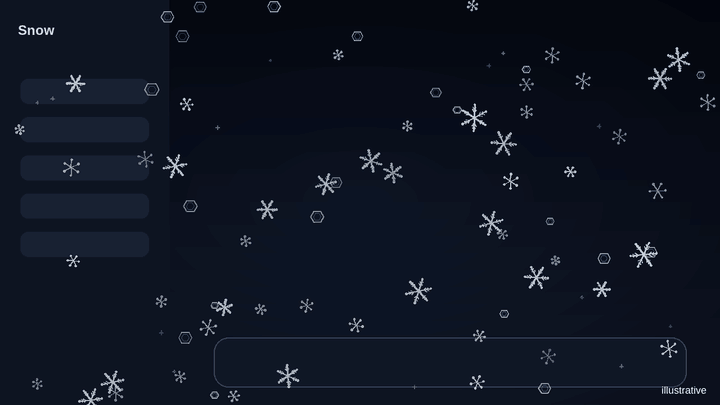
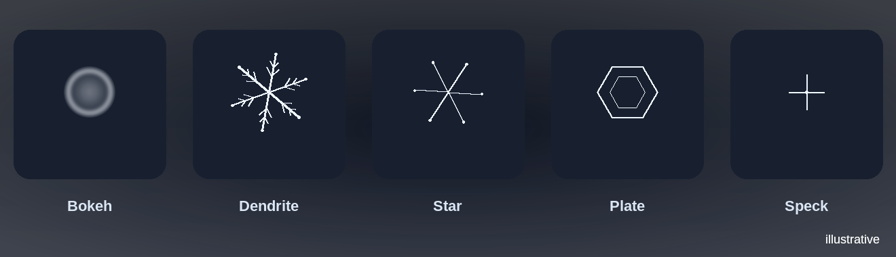

# XSnow-style snowfall

A client plugin for DeepSeek Harness: full-screen falling snow in the spirit of
XSnow.

> XSnow is referenced descriptively as a visual style. This project is not
> affiliated with, endorsed by, or derived from XSnow.

## Preview



*Illustrative particle render generated from the plugin's parameters, not a
screenshot of the running app. [Static frame](preview/x-snow.png).*



- Flakes of different sizes and depths: distant ones are small and dim, near
  ones are large and bright.
- Five particle shapes: soft bokeh for the far plane, six-armed dendrites,
  hexagonal plates, stars, and tiny ice specks.
- Near flakes rotate slowly, catch glints, and leave a faint motion-blur trail.
- Wind gusts and individual sway for every flake.
- Soft bokeh flakes with a subtle twinkle.
- Snow is drawn on a transparent `<canvas>` above the whole interface; it does
  not intercept the mouse or block text selection.
- Flake colors follow the light and dark themes.
- Under `prefers-reduced-motion: reduce` the snow does not fall: a static
  scatter of flakes remains.

## Installation

The plugin installs as the bundle `@local/dsh-x-snow`. After installation, the
`x-snow` row appears in the profile composition.

Sources: `dsh-x-snow/` in the workspace.

## Configuration

In `client.js`:

```js
const SNOW = {
  enabled: true,
  density: 1,      // flake-count multiplier
  speed: 1,        // fall-speed multiplier
  opacity: 0.9,    // maximum opacity
  minFlakes: 90,
  maxFlakes: 300,
};
```

The count is based on window area: roughly one flake per 10,000 CSS px², but no
fewer than `minFlakes` and no more than `maxFlakes`. On a 1920×1080 screen that
is about 207 flakes.

Depth and wind live in `makeFlake()` and `update()`: `layer` controls size,
speed, and brightness, while the sine terms in `update()` produce wind gusts.
Shape follows depth: far particles are bokeh and specks, near particles are
dendrites and plates. Rotation angle and spin speed also depend on the layer.

## How it works

Snowflake shapes are pre-rendered into five sprites per theme, so each particle
is one `drawImage` instead of dozens of strokes per frame. Dendrites and plates
have six arms, side branches, and a soft glow; bokeh is a bright disc with a
brighter rim, like an out-of-focus snowflake.

The canvas covers the whole window (`position: fixed`) with a very high
`z-index`, so snow is visible above the sidebar and dialogs. The canvas uses
`pointer-events: none` and `aria-hidden`, so it does not affect clicks, focus,
or screen readers.

DPR is capped so that even on 4K the canvas does not grow to tens of
megapixels.

## Disabling and removal

- Temporarily: turn off the `@local/dsh-x-snow` bundle in plugin settings.
- Permanently: remove the bundle through the plugin manager and delete the
  `dsh-x-snow` folder.

## Limitations

The plugin has not been verified visually in a browser (this environment has no
page control). Syntax, the manifest, canvas initialization, flake rendering, and
resource cleanup were checked.

## License

MIT. See [LICENSE](LICENSE). The preview illustrations in `preview/` are
original assets and are covered by the same license; their provenance is
documented in [preview/README.md](preview/README.md).
